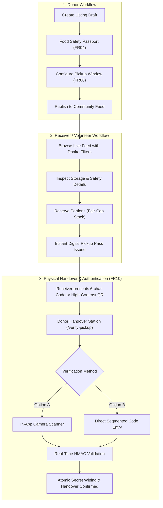
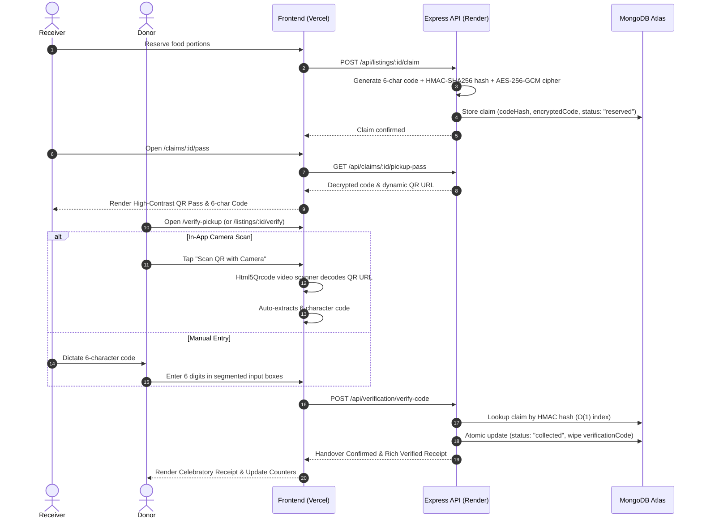
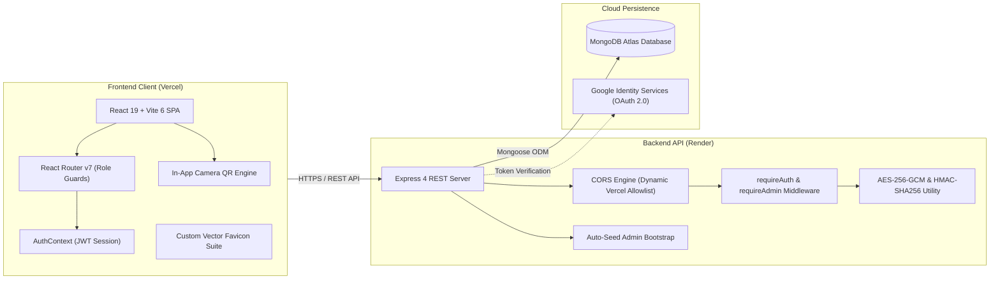

# 🌿 FoodBridge — Surplus Food Rescue & Redistribution Platform

> A community-driven web application connecting food donors (restaurants, bakeries, caterers, and households) with receivers and charitable organizations to eliminate food waste and coordinate safe, scheduled pickups.

[](https://foodbridge-up.vercel.app/)
[](https://foodbridge-api-sa2i.onrender.com)
[](https://react.dev/)
[](https://vitejs.dev/)
[](https://nodejs.org/)
[](https://expressjs.com/)
[](https://www.mongodb.com/)
[](LICENSE)

---

## 🌐 Live Deployments

| Component | Platform | Live URL | Health / Status |
| :--- | :--- | :--- | :--- |
| **Frontend Web App** | **Vercel** | [https://foodbridge-up.vercel.app/](https://foodbridge-up.vercel.app/) | Active (Production SPA) |

---

## Table of Contents

- [Visual Feature Showcases](#visual-feature-showcases)
- [System Architecture Topology](#system-architecture-topology)
- [Project Overview & Roles](#project-overview--roles)
- [Functional Requirements Matrix (FR01 – FR10 + Admin)](#functional-requirements-matrix)
- [Codebase Organization & Colocation Standard](#codebase-organization--colocation-standard)
- [Frontend Routes](#frontend-routes)
- [Master REST API Reference](#master-rest-api-reference)
- [Getting Started (Local Development)](#getting-started-local-development)
- [Production Deployment & Environment Variables](#production-deployment--environment-variables)

---

## Visual Feature Showcases

### 1. End-to-End Surplus Food Rescue Lifecycle



---

### 2. FR10 Dual-Layer Handover Security & Zero-Replay Lifecycle



---

## System Architecture Topology



---

## Project Overview & Roles

FoodBridge bridges surplus food from donors to local communities before it goes to waste. The platform provides a secure, role-based workflow where donors can list food items with strict storage and safety guidelines, schedule pickup windows, and coordinate with verified community recipients.

### Role Separation

- **Donors** (Restaurants, Bakeries, Caterers, Households):
  - Create food listings, configure food safety passports, and schedule collection windows.
  - Manage and edit published donations from a unified dashboard.
  - Verify recipient handover codes or scan recipient QR passes using the in-app camera scanner.
- **Receivers** (Shelters, Charities, Families, Individuals):
  - Browse community feed and inspect verified food safety passports.
  - Reserve available portions and receive a secure Digital Pickup Pass with a high-contrast QR ticket.
  - Manage active, completed, or cancelled reservations.
- **Volunteers** (Community Couriers, Dispatch Helpers):
  - Assist in delivery coordination and verify handovers between donors and recipients.
- **Administrators**:
  - Access the Control Center via `/admin`.
  - Manage user roles, provision admins, suspend/delete accounts, and moderate listings.

---

## Functional Requirements Matrix

| ID | Feature / Module | Status | Description |
| :--- | :--- | :---: | :--- |
| **FR01** | **User Registration** | ✅ | Multi-role account onboarding (Donor, Receiver, Volunteer) with email/password and Google OAuth 2.0. |
| **FR02** | **User Login & Recovery** | ✅ | Email/password login, Google One Tap sign-in, JWT session token, and password reset. |
| **FR03** | **Community Feed** | ✅ | Real-time public surplus food feed with live availability badges, portion counters, and donor profiles. |
| **FR04** | **Food Information** | ✅ | Food Freshness & Quality Passport: preparation time, storage conditions, allergens, and dietary tags. |
| **FR05** | **Create Food Listing** | ✅ | Multi-mode listing wizard with canvas-compressed device photo upload, presets, and portion configuration. |
| **FR06** | **Pickup Scheduling** | ✅ | Single authoritative collection schedule: opening and closing times, Dhaka area presets, and publishing. |
| **FR07** | **Search & Filtering** | ✅ | Real-time multi-facet filtering across Dhaka neighborhoods, food categories, availability, and pickup times. |
| **FR08** | **My Listings — Edit & Delete** | ✅ | Dedicated donor dashboard to manage active donations, continue drafts, or remove listings. |
| **FR09** | **Food Claiming & Reservation** | ✅ | Reserve portions with dynamic stock depletion, fair-share caps, and cancellation restocking. |
| **FR10** | **Pickup Verification & Pass** | ✅ | Handover authentication using 6-character HMAC-SHA256 hashed code, Digital QR Pass, in-app camera scanner, and secret wiping. |
| **Admin** | **Control Center (`/admin`)** | ✅ | Privileged dashboard for user roles, account suspension/deletion, platform metrics, and listing moderation. |

---

## Codebase Organization & Colocation Standard

FoodBridge follows an **industry-standard side-by-side colocation architecture**:
- **Components & Pages Colocation**: Every React component and page view is colocated 1:1 with its dedicated stylesheet (`HomeLayout.jsx` $\rightarrow$ `HomeLayout.css`, `AdminDashboardPage.jsx` $\rightarrow$ `AdminDashboardPage.css`), eliminating global CSS pollution and dead styles.
- **Global Design Tokens**: `client/src/styles/global.css` exclusively houses the dark glassmorphism design system tokens, typography variables, and reset rules.
- **Modular Backend Routers & Controllers**: Each business domain (`auth`, `listings`, `claims`, `pickupVerification`, `admin`) maintains separate, isolated controllers, routes, and Mongoose schemas.

```text
foodbridge-app/
├── client/                               # Frontend React 19 + Vite 6 Application
│   ├── public/                           # Static assets served at web root
│   │   ├── favicon.svg                   # Brand scalable vector favicon
│   │   ├── favicon.ico                   # Multi-resolution ICO (16x16 & 32x32)
│   │   ├── favicon-32x32.png             # Crisp raster fallback
│   │   └── apple-touch-icon.png          # iOS 180x180 bookmark icon
│   ├── src/
│   │   ├── components/                   # UI components colocated 1:1 with CSS
│   │   │   ├── AuthFrame.jsx / .css      # Shared authentication container & branding
│   │   │   ├── HomeLayout.jsx / .css     # Main navigation header & responsive sidebar
│   │   │   ├── ClaimModal.jsx            # Portion claim modal dialog
│   │   │   └── QRCodeDisplay.jsx         # Inline high-contrast SVG QR matrix generator
│   │   ├── context/                      # Global React context providers
│   │   │   └── AuthContext.jsx           # JWT session, auto-login, and auth state
│   │   ├── pages/                        # Page views colocated 1:1 with CSS
│   │   │   ├── HomePage.jsx / .css       # Public community surplus food feed
│   │   │   ├── LoginPage.jsx             # Sign-in & password recovery
│   │   │   ├── RegisterPage.jsx          # Multi-role account onboarding
│   │   │   ├── FoodListingPage.jsx / .css# Donor listing creation wizard
│   │   │   ├── FoodInformationPage.jsx   # Food Safety & Quality Passport
│   │   │   ├── PickupSchedulePage.jsx    # Collection window & location scheduler
│   │   │   ├── MyListingsPage.jsx / .css # Donor donation management dashboard
│   │   │   ├── MyClaimsPage.jsx / .css   # Receiver food reservation management
│   │   │   ├── PickupPassPage.jsx / .css # Digital Pickup Pass with live QR code
│   │   │   ├── PickupVerificationPage.jsx# Handover station with live camera QR scanner
│   │   │   └── AdminDashboardPage.jsx/.css# Admin Control Center
│   │   ├── services/                     # Network layer
│   │   │   └── api.js                    # Fetch wrapper with Render cold-start handling
│   │   └── styles/                       # Global stylesheet directory
│   │       └── global.css                # Dark glassmorphism tokens & CSS reset
│   ├── vercel.json                       # Vercel SPA client-side rewrite configuration
│   └── package.json
│
├── server/                               # Backend Node.js + Express REST API
│   ├── src/
│   │   ├── controllers/                  # Business logic handlers
│   │   │   ├── authController.js         # Register, login, Google OAuth, password reset
│   │   │   ├── listingController.js      # Food listing CRUD, feeds, and filters
│   │   │   ├── claimController.js        # Reservation stock, caps, and cancellations
│   │   │   ├── pickupVerificationController.js # Verification station & QR pass
│   │   │   └── adminController.js        # Role management, suspensions, moderation
│   │   ├── middleware/                   # Express middleware guards
│   │   │   ├── requireAuth.js            # JWT bearer token verification
│   │   │   └── requireAdmin.js           # Admin privilege check
│   │   ├── models/                       # Mongoose ODM schemas
│   │   │   ├── User.js                   # Users with roles & suspension status
│   │   │   ├── Listing.js                # Food donations with schedule & safety passport
│   │   │   └── Claim.js                  # Portion claims with hashed handover secrets
│   │   ├── routes/                       # Express routers
│   │   │   ├── auth.js                   # /api/auth
│   │   │   ├── listings.js               # /api/listings
│   │   │   ├── claims.js                 # /api/claims
│   │   │   ├── pickupVerification.js     # /api/verification & /api/listings/:id/verify
│   │   │   └── admin.js                  # /api/admin
│   │   ├── utils/                        # Security & bootstrap helpers
│   │   │   ├── verificationCode.js       # AES-256-GCM cipher & HMAC-SHA256 hashing
│   │   │   └── bootstrapAdmin.js         # Auto-seeding default admin on startup
│   │   └── app.js                        # Server entry point, CORS & route mounting
│   └── package.json
│
├── .gitignore                            # Comprehensive git exclusion rules
├── vercel.json                           # Root deployment configuration for Vercel
└── README.md                             # Project documentation
```

---

## Frontend Routes

| Route | Component | Access | Purpose |
| :--- | :--- | :--- | :--- |
| `/` | `HomePage.jsx` | Public | Real-time community surplus feed with search and filters. |
| `/login` | `LoginPage.jsx` | Guest | Email & Google sign-in; password recovery. |
| `/register` | `RegisterPage.jsx` | Guest | Multi-role user registration. |
| `/listings/new` | `FoodListingPage.jsx` | Donor | Step 1: Create surplus food listing draft. |
| `/listings/:id/information` | `FoodInformationPage.jsx` | Public / Donor | Step 2 / View: Food safety passport and storage environment. |
| `/listings/:id/pickup` | `PickupSchedulePage.jsx` | Donor | Step 3: Configure pickup schedule and publish listing. |
| `/listings/mine` | `MyListingsPage.jsx` | Donor | Manage published donations, edit portions, continue drafts. |
| `/claims/mine` | `MyClaimsPage.jsx` | Receiver | Manage active reservations, view pickup pass, delete cancelled claims. |
| `/claims/:id/pass` | `PickupPassPage.jsx` | Receiver / Volunteer | Digital Pickup Pass with 6-char code, high-contrast QR, and live status. |
| `/verify-pickup` | `PickupVerificationPage.jsx` | Donor / Volunteer | Universal verification station with in-app camera scanner & direct code entry. |
| `/listings/:id/verify` | `PickupVerificationPage.jsx` | Donor / Volunteer | Listing-specific pickup station (pending vs completed history). |
| `/admin` | `AdminDashboardPage.jsx` | Admin only | Control Center for user roles, moderation, and platform metrics. |

---

## Master REST API Reference

All protected endpoints require an `Authorization: Bearer <token>` header.

### Authentication (`/api/auth`)
| Method | Endpoint | Access | Description |
| :---: | :--- | :---: | :--- |
| `POST` | `/api/auth/register` | Public | Register new user with role (`donor`, `receiver`, `volunteer`). |
| `POST` | `/api/auth/login` | Public | Email/password sign-in; returns JWT token and user profile. |
| `POST` | `/api/auth/google` | Public | Verify Google OAuth token; login or register user. |
| `POST` | `/api/auth/reset-password` | Public | Reset account password with validation. |
| `GET` | `/api/auth/me` | User | Get current session user data on app mount. |

### Food Listings (`/api/listings`)
| Method | Endpoint | Access | Description |
| :---: | :--- | :---: | :--- |
| `GET` | `/api/listings/feed` | Public | Public surplus food feed with category & area filtering. |
| `GET` | `/api/listings/mine` | Donor | Retrieve all listings created by the authenticated donor. |
| `POST` | `/api/listings` | Donor | Create new food listing draft. |
| `GET` | `/api/listings/:id` | Authenticated | Retrieve listing details and schedule data. |
| `PATCH` | `/api/listings/:id` | Donor (Owner) | Update listing title, portions, category, or photo. |
| `DELETE` | `/api/listings/:id` | Donor (Owner) | Delete a food listing. |
| `GET` | `/api/listings/:id/information` | Public | Get Food Safety & Quality Passport details. |
| `PATCH` | `/api/listings/:id/information` | Donor (Owner) | Save food condition, storage details, and safety notes. |
| `PATCH` | `/api/listings/:id/pickup` | Donor (Owner) | Save collection window, location, and publish as `available`. |

### Claims & Reservations (`/api/claims`)
| Method | Endpoint | Access | Description |
| :---: | :--- | :---: | :--- |
| `POST` | `/api/listings/:id/claim` | Receiver | Reserve portions; issues HMAC-hashed verification code. |
| `GET` | `/api/claims/mine` | Receiver | Retrieve user's active, completed, and cancelled reservations. |
| `PUT` | `/api/claims/:id` | Receiver (Owner) | Update reservation portions, ETA, or notes. |
| `POST` | `/api/claims/:id/cancel` | Receiver (Owner) | Cancel reservation and return portions back to feed. |
| `DELETE` | `/api/claims/:id` | Receiver (Owner) | Permanently delete a cancelled reservation record. |

### Pickup Verification (`/api/verification` & `/api`)
| Method | Endpoint | Access | Description |
| :---: | :--- | :---: | :--- |
| `GET` | `/api/claims/:id/pickup-pass` | Receiver / Volunteer | Decrypted 6-char verification code, QR URL, and live status. |
| `POST` | `/api/listings/:id/verify-pickup` | Donor / Volunteer | Verify 6-char code for listing; marks completed and wipes secret. |
| `POST` | `/api/verification/verify-code` | Donor / Volunteer | Universal 1-step verification across all donor listings. |
| `GET` | `/api/listings/:id/verification` | Donor / Volunteer | View pending vs completed handover history for a listing. |
| `GET` | `/api/verification/active-listings` | Donor / Volunteer | Retrieve donor's listings with pending collections. |

### Administration (`/api/admin`)
| Method | Endpoint | Access | Description |
| :---: | :--- | :---: | :--- |
| `GET` | `/api/admin/stats` | Admin | High-level platform summary (users by role, rescued portions). |
| `GET` | `/api/admin/users` | Admin | Searchable user registry with role and status filtering. |
| `POST` | `/api/admin/users/create-admin` | Admin | Directly provision a new administrator account. |
| `PATCH` | `/api/admin/users/:id/role` | Admin | Change user role (`donor`, `receiver`, `volunteer`, `admin`, `member`). |
| `PATCH` | `/api/admin/users/:id/status` | Admin | Toggle account status between `active` and `suspended`. |
| `DELETE` | `/api/admin/users/:id` | Admin | Permanently delete a suspended user account from the database. |
| `GET` | `/api/admin/listings` | Admin | Search all platform listings for moderation. |
| `DELETE` | `/api/admin/listings/:id` | Admin | Permanently delete a listing and its claims. |

---

## Getting Started (Local Development)

### Prerequisites
- **Node.js**: v18.0.0 or higher
- **MongoDB**: Local MongoDB instance (`mongodb://127.0.0.1:27017/foodbridge`) or MongoDB Atlas
- **Package Manager**: `npm`

### 1. Backend Setup
```bash
cd server
npm install
cp .env.example .env
npm run dev
```

### 2. Frontend Setup
```bash
cd ../client
npm install
cp .env.example .env
npm run dev
```
Open **`http://localhost:5173`** in your browser.

---

Log in at `/login` and navigate to **`/admin`** to access the Control Center.

---

## Production Deployment & Environment Variables

### 1. Backend on Render (`foodbridge-api`)
- **Runtime**: Node.js
- **Build Command**: `npm --prefix server install`
- **Start Command**: `npm --prefix server start`

| Variable | Required | Description | Production Value |
| :--- | :---: | :--- | :--- |
| `PORT` | Optional | Express server port (default 4000) | `4000` |
| `CLIENT_ORIGIN` | Required | Allowed CORS frontend origin | `https://foodbridge-up.vercel.app` |
| `MONGODB_URI` | Required | MongoDB Atlas connection string | `mongodb+srv://...` |
| `JWT_SECRET` | Required | Secret key for signing JWTs and HMAC hashes (min 32 chars) | `fb_sec_...` |
| `GOOGLE_CLIENT_ID` | Optional | Google OAuth 2.0 Web Client ID | `484382...apps.googleusercontent.com` |


### 2. Frontend on Vercel (`foodbridge`)
- **Framework Preset**: Vite
- **Root Directory**: `.` (or `client`)
- **Build Command**: `npm --prefix client run build`
- **Output Directory**: `client/dist`

